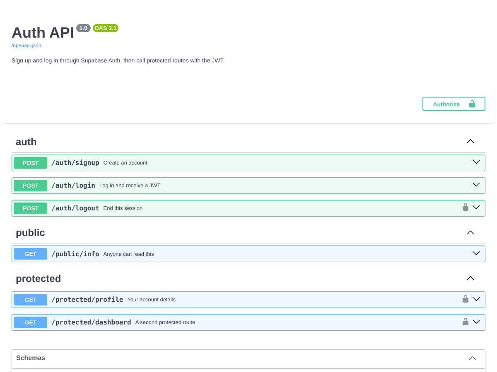

# Auth API: Login & Protect

A FastAPI server that lets users **sign up, log in and log out** through **Supabase Auth**, and guards routes so only a request carrying a valid JWT gets in.

Built for FlyRank's Backend AI Engineering track, assignment **Auth: Login & protect** (Python lane).



## How it works

```
Client ──email+password──▶ this API ──▶ Supabase Auth (checks password, issues JWT)
Client ◀──access_token────  this API ◀──
Client ──Authorization: Bearer <token>──▶ this API ──get_user(token)──▶ Supabase
                                          200 + data, or 401
```

This server never stores passwords or signs tokens. Supabase is the identity provider; the server's job is to pass credentials through and to **check every token on every protected request**.

## Set up

1. Create a free project at [supabase.com](https://supabase.com).
2. In the dashboard, open **Project Settings → API** and copy the **Project URL** and the **anon public** key. Don't use the `service_role` key: it bypasses all security and must never sit in an app like this.
3. For quick testing, turn off **Authentication → Sign In / Providers → Email → Confirm email**. With it on, new users must click the email link before they can log in (signup then returns `"email_confirmation_required": true`).
4. Locally:

```bash
cp .env.example .env          # paste your URL and anon key into .env
pip install -r requirements.txt
uvicorn main:app --reload
```

The log should show `Server running and connected to Supabase`. The app refuses to start if `SUPABASE_URL` or `SUPABASE_KEY` is missing. `.env` is in `.gitignore`, so your keys never reach GitHub.

## Endpoints

| Method | Path | Auth? | Success | Errors |
|---|---|---|---|---|
| POST | `/auth/signup` | No | 201 + user | 400 missing field, or Supabase rejected it (weak password, bad email) |
| POST | `/auth/login` | No | 200 + `access_token`, `refresh_token`, `expires_in` | 400 missing field, 401 `Invalid login credentials` |
| POST | `/auth/logout` | **Bearer** | 204 | 401 |
| GET | `/public/info` | No | 200 | |
| GET | `/protected/profile` | **Bearer** | 200 + id, email, created_at, last_sign_in_at | 401 |
| GET | `/protected/dashboard` | **Bearer** | 200 | 401 |

The 401 bodies are exact: `{"error": "Access token required"}` when the header is missing or isn't `Bearer <token>`, and `{"error": "Invalid or expired token"}` when Supabase rejects the token. Each 401 also carries `WWW-Authenticate: Bearer`, as the HTTP spec asks.

## Try it with curl

```bash
curl -i -X POST http://localhost:8000/auth/signup -H "Content-Type: application/json" \
  -d '{"email":"test@example.com","password":"password123"}'                 # 201

curl -i -X POST http://localhost:8000/auth/login -H "Content-Type: application/json" \
  -d '{"email":"test@example.com","password":"password123"}'                 # 200, copy access_token

TOKEN=<paste access_token>
curl -i http://localhost:8000/public/info                                    # 200
curl -i http://localhost:8000/protected/profile                              # 401 Access token required
curl -i http://localhost:8000/protected/profile -H "Authorization: Bearer $TOKEN"     # 200
curl -i http://localhost:8000/protected/profile -H "Authorization: Bearer ${TOKEN}x"  # 401 Invalid or expired token
curl -i -X POST http://localhost:8000/auth/logout -H "Authorization: Bearer $TOKEN"   # 204
```

## Swagger UI

Open `/docs`. Protected routes show a padlock. Log in with **Try it out** on `/auth/login`, copy `access_token`, click **Authorize**, paste the token (without the word "Bearer"), and the padlocked routes now work from the browser.

## Design decisions

- **One guard, used everywhere.** `auth.py` has two FastAPI dependencies: `bearer_token` extracts the token, and `require_user` verifies it with Supabase and returns the user. A route is protected by adding `user: dict = Depends(require_user)`; the route body only runs once the token has passed.
- **`HTTPBearer(auto_error=False)`.** Plugging into FastAPI's security scheme is what makes the Authorize button and padlocks appear. With `auto_error=False` the app writes its own 401 messages instead of FastAPI's default 403.
- **A new Supabase client per request.** The Python SDK stores the last logged-in session inside the client object. A single shared client would let one user's login overwrite another's under concurrent requests, so the factory builds a fresh client with session storage and auto-refresh turned off.
- **Same login error whatever went wrong.** Wrong password and unknown email both return `Invalid login credentials`, so the API can't be used to find out which emails have accounts.
- **Logout ends this session only** (`scope="local"`), not the user's sessions on other devices.
- **Verification asks Supabase on every request** (`auth.get_user(token)`), which also catches tokens from sessions that were logged out. The faster alternative is to verify the JWT's signature locally with the project's JWT secret; that skips a network call, but a logged-out token then keeps working until it expires.

## Tests

```bash
pip install -r requirements-dev.txt
pytest -q
```

19 tests run against an in-memory fake of Supabase Auth, so they need no network or account. They cover every status code in the table, malformed headers (`Basic …`, `Bearer` with no token, a bare token), a tampered token, the shared guard on both protected routes, and a token that stops working after logout.
